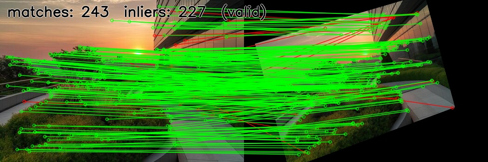
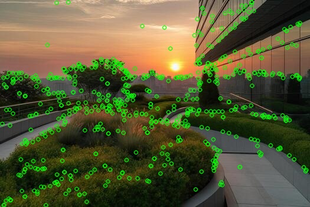

# Image Search Using VLAD

**Course:** CSS 587 - Computer Vision  
**Student:** Nityasree Bellamkonda & Meghana Reddy Gavinolla
**Semester:** Autumn 2026

## Project Overview

This project implements an image retrieval system using
Vector of Locally Aggregated Descriptors (VLAD).

The goal is to retrieve the five most similar images
from a dataset given a query image.

## Research Paper

Jégou et al., "Aggregating Local Descriptors into a
Compact Image Representation," CVPR 2010.

## Implementation Plan

1. Image loading and preprocessing
2. SIFT feature extraction
3. K-means visual vocabulary generation
4. VLAD descriptor encoding
5. Image similarity calculation
6. Top-5 image retrieval
7. Performance evaluation and comparison

## Current Progress

### November 16, 2026

- Created the C++ project structure.
- Configured CMake with OpenCV 4.5.5.
- Implemented SIFT feature extraction.
- Successfully detected 616 keypoints in a test image.
- Generated 616 descriptors, each with 128 dimensions.
- Saved a visualization of the detected keypoints.

### November 23, 2026 (Meghana: geometric verification)

- Added the `GeometricVerifier` class (`src/GeometricVerifier.h/.cpp`).
  - SIFT matching with `knnMatch` (k = 2) and Lowe's ratio test (0.75).
  - RANSAC model fitting with `cv::findHomography` (or `cv::findFundamentalMat`).
  - Scoring by inlier count, and stable re-ranking of VLAD candidates.
  - Match visualization: inliers in green, outliers in red.
- Added the `verify_pair` test program (`apps/verify_pair.cpp`) with
  `selftest`, `pair` and `rerank` modes.
- Self-test on the sample image: a warped copy gave 243 good matches and
  227 inliers (accepted); an unrelated image gave 1 match and 0 inliers
  (rejected). Re-ranking moved the correct image to rank 1.

## Initial Result

## Build Instructions

Configure the project:

    cmake -S . -B build -DOpenCV_DIR=/Users/nityabellamkonda/opencv-4.5.5-install/lib/cmake/opencv4

Build the program:

    cmake --build build

Run:

    ./build/vlad_search

## Geometric Verification Test Program

After building, run from the project folder:

    ./build/verify_pair selftest data/sample/test.jpg
    ./build/verify_pair pair data/holidays/100000.jpg data/holidays/100001.jpg --out results/matches.jpg
    ./build/verify_pair rerank data/holidays/100000.jpg data/holidays/100001.jpg data/holidays/100100.jpg

Options for `pair`: `--model H|F` (homography or fundamental matrix),
`--ratio 0.75`, `--thresh 5`, `--out <file>`.

On macOS with Homebrew OpenCV, `cmake -S . -B build` finds OpenCV without
setting `OpenCV_DIR`.

## Next Steps

- Extract SIFT descriptors from multiple images.
- Implement k-means clustering.
- Generate VLAD representations.
- Begin testing image retrieval.
- Test geometric verification on Holidays image pairs and tune the ratio and RANSAC threshold.
- Connect the verifier to the VLAD top-20 list once VLAD encoding is ready.

